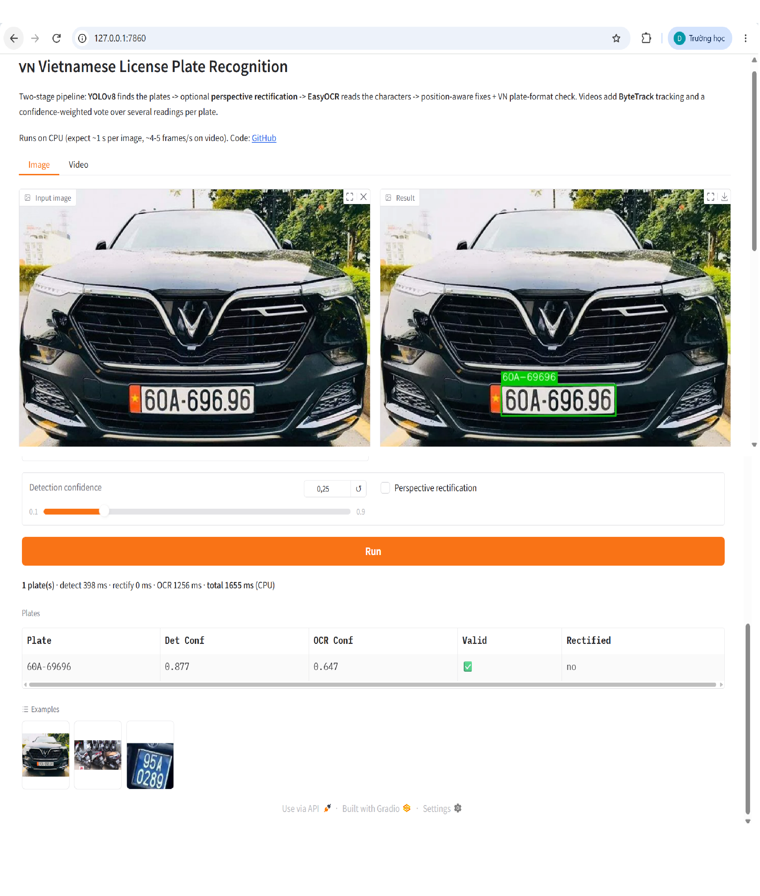
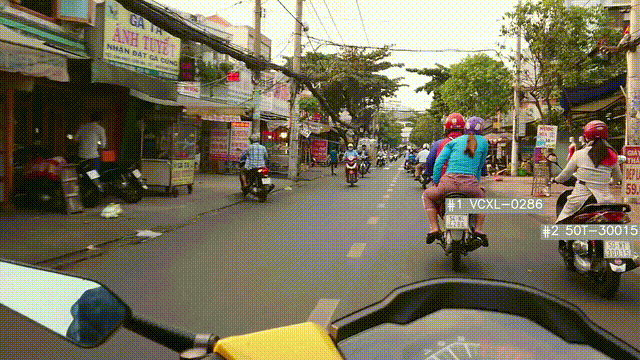
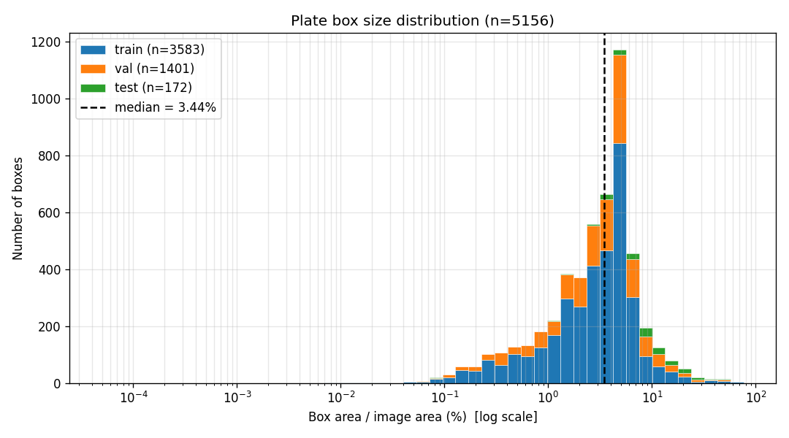
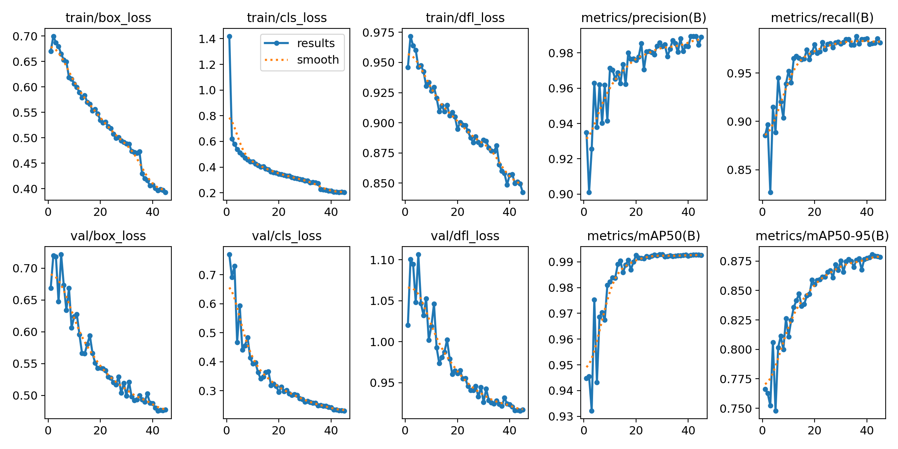
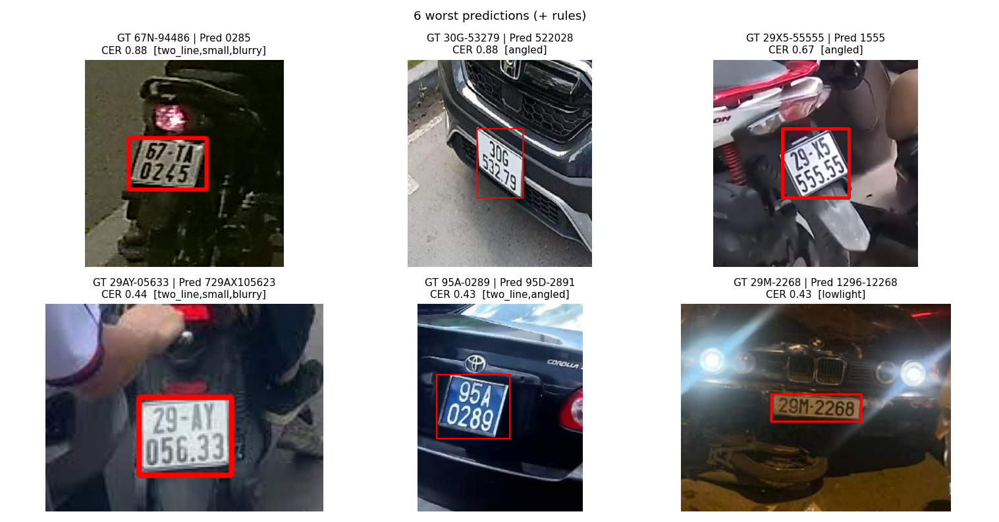

# VN-PlateOCR

Detect and read Vietnamese license plates in images and videos with a YOLOv8n detector, EasyOCR and Vietnamese plate-format rules, on a laptop CPU.

[](https://www.python.org/)
[](https://docs.ultralytics.com/models/yolov8/)
[](https://www.gradio.app/)
[](https://huggingface.co/spaces/CoDa19/vn-plate-ocr)
[](https://github.com/CoDa-git19/-vn-plate-ocr/actions/workflows/ci.yml)

## Demo





Project page (static, recorded results): **https://huggingface.co/spaces/CoDa19/vn-plate-ocr**

There is no live demo: Hugging Face no longer runs Gradio Spaces on free accounts. The demo runs locally with `python app.py` (see [Installation & Usage](#installation--usage)).

## Overview

Reading a plate in a street photo is a small-object problem: the plate often covers less than 1% of the frame, and an OCR model run on the whole image also reads shop signs and stickers. VN-PlateOCR works in two stages: YOLOv8n locates each plate, then the padded crop is optionally rectified, preprocessed and read by EasyOCR, and the result is corrected and validated against Vietnamese plate formats; on video, ByteTrack tracking and multi-frame voting give one reading per vehicle. The detector reaches **0.981 mAP50** on the dataset test split, but end-to-end exact match on a hand-labelled set of 45 real-world photos is only **15.6%**: OCR, not detection, is the weak and slow part (88% of CPU time).

## Architecture

```
Input --> YOLOv8n --> Crop + Pad --> Rectify --> Preprocess --> EasyOCR --> VN Format Validator --> Output
             |        (box + 5%)   (optional)    (CLAHE)                   (positional fixes      (plate text,
             |                                                              + regex)               confidences)
             |
             +-- video --> ByteTrack --> Multi-frame Voting --> one plate per track
                          (one ID per    (OCR every N frames,
                           plate)         confidence-weighted)
```

Post-processing restricts the series position to the 20 letters used on Vietnamese civilian plates, so any `I`, `J`, `O`, `Q`, `R` or `W` read at that position is treated as a recognition error (mapped to its look-alike when unambiguous, otherwise the plate is marked invalid).

## Results

**Detection** (dataset test split, 169 images, 172 plates):

| Model | Params | Precision | Recall | mAP50 | mAP50-95 |
|---|---:|---:|---:|---:|---:|
| YOLOv8n | 3.1M | 0.978 | 0.975 | 0.981 | 0.782 |

**End-to-end** (manual test set, 45 images, full pipeline, CPU):

| Exact Match | CER | Detection Recall | End-to-end latency p50 |
|---:|---:|---:|---:|
| 15.6% | 0.224 | 100.0% | 1630 ms |

Exact Match compares the predicted and true plate after removing `-` and `.`; CER is the Levenshtein distance divided by the plate length; Detection Recall is the share of images with at least one detected plate. When several plates are detected, the prediction closest to the ground truth (lowest CER) is scored.

## Ablation Study

Each configuration adds one stage to the row above (manual test set, n=45, `models/best.pt`):

| Configuration | Exact Match | CER | Detection Recall | Delta EM vs previous |
|---|---:|---:|---:|---:|
| 1. baseline (raw crop -> EasyOCR) | 6.7% | 0.282 | 100.0% | - |
| 2. + preprocess (upscale, CLAHE, threshold) | 6.7% | 0.255 | 100.0% | +0.0 pts |
| 3. + rectify | 6.7% | 0.240 | 100.0% | +0.0 pts |
| 4. + rules (VN format validator) | 15.6% | 0.224 | 100.0% | +8.9 pts |

Preprocessing and rectification lower CER but do not turn any additional plate into an exact match; the format rules account for the whole Exact Match gain. With 45 images, one image is 2.2 points.

## Per-Slice Results

Full pipeline, grouped by tag (an image with several tags counts in each slice; `clean` = no tag):

| Slice | n | Exact Match |
|---|---:|---:|
| two_line | 15 | 6.7% |
| angled | 11 | 18.2% |
| lowlight | 3 | 33.3% |
| small | 6 | 0.0% |
| blurry | 16 | 12.5% |
| clean | 12 | 25.0% |

`lowlight` has fewer than 5 samples and is not reliable. Two-line and small plates are the weakest slices.

## Video Pipeline

ByteTrack assigns one ID per plate; OCR runs on a tracked box only every N frames (default 3), when the box is large enough (> 1500 px²) and until the track has `min_votes` readings (default 3). The displayed text is a confidence-weighted vote that prefers readings matching a valid Vietnamese format.

| Clip | Single-frame accuracy | Voted accuracy | OCR calls saved |
|---|---:|---:|---:|
| video1 | 3.2% | 8.3% | 485 |
| video2 | 0.0% | 0.0% | 481 |
| video3 | 0.0% | 0.0% | 580 |

Tracking and voting skip about 95% of the OCR calls that reading every box in every frame would need. Voting helps only when some single-frame readings are right: on these stock clips, plates are small and motion-blurred, so accuracy stays near zero (see [Limitations](#limitations--future-work)).

## Latency Benchmark

Detector only, CPU (Intel i5-1135G7), 100 timed calls over 30 images after 5 warm-up calls, full `detect()` including letterbox and NMS:

| Configuration | median ms | p95 ms | speedup vs PyTorch CPU |
|---|---:|---:|---:|
| PyTorch CPU | 265.6 | 651.6 | 1.00x |
| ONNX Runtime CPU (opset 12, static 640x640) | 199.5 | 282.5 | 1.33x |

ONNX Runtime has a much tighter tail (p95 282 vs 652 ms) even though the static export always processes a 640x640 input, while PyTorch letterboxes to the smallest multiple of 32 (for example 640x480, 25% fewer pixels). Across four runs on this laptop the ONNX/PyTorch speedup ranged from 0.85x to 1.33x (thermal throttling and background load), so the median difference is within run-to-run noise; the conclusion that OCR is the bottleneck does not change. On identical input both backends give the same boxes (< 1 px difference on 10/10 images).

Per stage, full pipeline (30 images, 47 plates):

| Stage | median ms | p95 ms | share of total time |
|---|---:|---:|---:|
| detect | 179.1 | 328.4 | 12% |
| rectify | 1.9 | 22.1 | 0% |
| ocr | 1086.0 | 2756.0 | 88% |
| total | 1312.8 | 2971.6 | 100% |

The bottleneck is OCR: speeding up the detector, with ONNX or otherwise, can save at most 12% of the time.

## Model Selection

| Weights | Params | mAP50 (test split) | Exact Match (manual set) | Detect p50 (ms) | End-to-end p50 (ms) |
|---|---:|---:|---:|---:|---:|
| YOLOv8n | 3.1M | 0.981 | 15.6% | 240 | 1630 |
| YOLOv8s | 11.1M | 0.973 | 17.8% | 604 | 2022 |

YOLOv8n is the default: equal or better detection (mAP50 0.981 vs 0.973) with 3.6x fewer parameters and about 2.5x faster detection on CPU. The +2.2 point Exact Match of v8s is one image out of 45, within noise.

## Dataset

- **Training data:** [Vietnam License Plate v2](https://universe.roboflow.com/vietnam-license/vietnam-license-plate-hjswj) on Roboflow Universe (CC BY 4.0), 4,534 images with 5,156 plates: 3,132 train / 1,233 validation / 169 test. It has two classes (`0`, `1`), both license plates; the pipeline treats them as one.
- **Small objects:** the median plate covers 3.2% of the image in the training split, and about 17% of training and validation plates cover less than 1%. Test-split plates are larger (median 8.4%), so the 0.981 mAP50 is optimistic for small, distant plates.



- **Manual test set:** 45 photos labelled by hand with `scripts/label_tool.py` (plate text + tags), partly taken from the dataset test split and partly collected from the web or photographed. It is kept out of the repository (`data/manual_test/` is git-ignored) because it contains real license plates.
- **Sample images:** `examples/1.jpg` and `examples/2.png` come from the dataset test split (CC BY 4.0) and are not part of the manual test set.

## Installation & Usage

The trained weights are not tracked in git: train them (see [Training](#training)) or download them from the [v1.0 release](https://github.com/CoDa-git19/-vn-plate-ocr/releases/tag/v1.0), and place them at `models/best.pt`, or point `PLATE_WEIGHTS` to another `.pt` file. Python 3.10-3.12; everything runs on CPU.

**bash (Linux / macOS)**

```bash
git clone https://github.com/CoDa-git19/-vn-plate-ocr.git
cd ./-vn-plate-ocr
python3 -m venv .venv
source .venv/bin/activate
pip install -r requirements.txt

# image: annotated output + plate list
python -m src.pipeline --image examples/1.jpg --output out.jpg --weights models/best.pt
# video: tracking + voting (add --gt "59H1-23456" to score a known plate)
python -m src.video_pipeline --input examples/video1.mp4 --output out.mp4 --weights models/best.pt
# Gradio app on http://127.0.0.1:7860
python app.py
```

**PowerShell (Windows)**

```powershell
git clone https://github.com/CoDa-git19/-vn-plate-ocr.git
cd .\-vn-plate-ocr
python -m venv .venv
.\.venv\Scripts\Activate.ps1          # if blocked: Set-ExecutionPolicy -Scope Process RemoteSigned
pip install -r requirements.txt

python -m src.pipeline --image examples\1.jpg --output out.jpg --weights models\best.pt
python -m src.video_pipeline --input examples\video1.mp4 --output out.mp4 --weights models\best.pt
python app.py
```

Evaluation and benchmark (need `pip install -r requirements-dev.txt` for tests):

```bash
python -m src.evaluate --weights models/best.pt --csv data/manual_test.csv          # ablation + slices
python -m src.evaluate --compare models/best_yolov8n.pt models/best_yolov8s.pt     # + mAP50, latency
python scripts/benchmark.py --weights models/best.pt --images data/manual_test/images
pytest -q
```

## Training

The detector was fine-tuned from COCO-pretrained `yolov8n.pt` on Google Colab (T4 GPU) for 45 epochs at 640 px, batch 16, with early-stopping patience 12; training took about 40 minutes. The best checkpoint (epoch 42) reached 0.993 mAP50 and 0.881 mAP50-95 on the validation split. To reproduce, download the dataset and train with:

```bash
export ROBOFLOW_API_KEY=...            # Colab: os.environ["ROBOFLOW_API_KEY"] = userdata.get("ROBOFLOW_API_KEY")
python scripts/prepare_data.py --roboflow
python scripts/train.py --epochs 45    # copies best.pt to models/best_yolov8n.pt
cp models/best_yolov8n.pt models/best.pt
```



## Error Analysis

38 of the 45 manual-test images are not an exact match. The errors fall into three overlapping groups:

1. **Near misses (18 of 38):** one character wrong, typically a confusion the rules do not cover, such as the series letter `A` read as `4` (`29A-12***` -> `294-12***`; last characters masked).
2. **Two-line plates (14 of 38):** a line is dropped, or the two lines are merged with extra characters, which also changes the plate length (15 of 38 errors have the wrong number of characters).
3. **Small, blurry or low-light plates (17 of 38):** EasyOCR returns fragments; the `small` slice has 0% exact match.



## Limitations & Future Work

- **Small test set:** 45 images, so one image moves Exact Match by 2.2 points and some slices have fewer than 5 samples.
- **OCR is not fine-tuned:** EasyOCR's generic English model is the main source of error and 88% of latency. Next steps: fine-tune a recognizer on Vietnamese plate crops and read each crop once instead of twice.
- **Night conditions:** only 3 low-light images were tested; glare and headlights are not handled.
- **Video:** accuracy is 0% on two of three stock clips because plates are small and motion-blurred; voting cannot fix readings that are all wrong.
- **No INT8 quantization:** the ONNX export is FP32 with a static 640x640 input, and its median speedup over PyTorch on CPU is small and unstable (0.85x to 1.33x across runs).
- **Privacy:** the manual test set contains real license plates and is not published. `src/evaluate.py --blur-failures` masks the last three characters in the failure figure; do not publish recognized plates of identifiable vehicles without consent.

## Project Structure

```
app.py                 Gradio demo (Image and Video tabs)
src/
  detect.py            YOLOv8 wrapper: detection, ByteTrack tracking, crop/pad helpers
  ocr.py               EasyOCR reading, preprocessing, VN plate normalization
  rectify.py           perspective rectification with safety checks
  pipeline.py          image pipeline: detect -> crop -> rectify -> OCR -> validate
  video_pipeline.py    tracking + multi-frame voting
  evaluate.py          ablation, per-slice metrics, model comparison, failure figure
scripts/
  prepare_data.py      dataset download, merge, validation, EDA plots
  train.py             YOLOv8 fine-tuning
  label_tool.py        fast ground-truth labelling for the manual test set
  benchmark.py         ONNX export, PyTorch vs ONNX Runtime latency, per-stage timing
tests/                 pytest unit tests (no weights needed)
examples/              sample images and videos
docs/                  figures, results, prompt summary
models/                weights (not tracked)
data/manual_test/      private manual test set (not tracked)
.github/workflows/     CI: ruff + pytest with light dependencies (requirements-ci.txt)
requirements*.txt      runtime / dev / CI dependencies
LICENSE                MIT
```

## AI-Assisted Development

This project was built with an AI coding assistant (Claude Code) that drafted code, tests and documentation from my specifications, while I set the requirements, reviewed the changes and ran every experiment. The prompts used in each phase are summarized in [docs/prompts.md](docs/prompts.md).

## License

Released under the MIT License. See [LICENSE](LICENSE).
